<a href="https://hellonayeem.com"></a>

Hi, I'm Niem. I run <a href="https://website-tnxbd.vercel.app"><b>TNXBD IT Solution</b></a>, a software studio in Mirpur, Dhaka.
For five years I've been designing and building the systems businesses run on: ERPs, HR platforms, online stores and the APIs that tie them together.
I like reliable technology, clear code and shipping things people actually use.

<a href="https://github.com/naayeem01/ShortLink"></a>
<a href="https://github.com/naayeem01/Trimly"></a>
<a href="https://github.com/naayeem01/Zkteco-Link-DSK"></a>
<a href="https://github.com/naayeem01/MediSlot"></a>
<a href="https://github.com/naayeem01/Website-tnxbd"></a>

Most of my client work (ERP, HRMS, fintech, e-commerce) lives in private repos under NDA. <a href="mailto:info@tnxbd.com">Ask me for a case study.</a>

  


<b>Open the full toolbox</b>

 

**Frontend** 

**Backend** 

**Data** 

**Cloud & DevOps** 

**Everyday tools** 

<b>What I build, and for whom</b>

 

- **E-commerce:** storefronts, multi-vendor marketplaces, payment integrations
- **SaaS:** multi-tenant apps with roles, subscriptions and third-party integrations
- **Enterprise:** ERP and HRMS modules, supply chain, biometric attendance, finance
- **Analytics:** real-time dashboards, BI and forecasting tools
- **APIs:** REST and GraphQL services, legacy migrations, data sync
- **Web apps:** SPAs and PWAs that work well on phones first

**Industries:** financial services · retail · healthcare · manufacturing · real estate · education · telecom · government

 

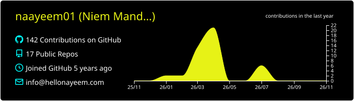

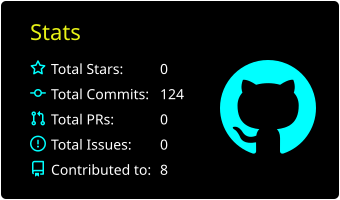
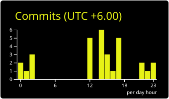
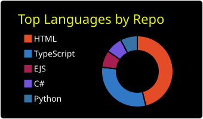
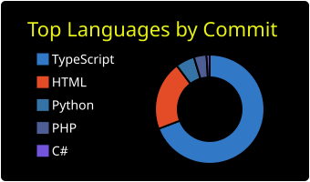

<b>Contribution graph</b> (public activity, refreshed daily)

 

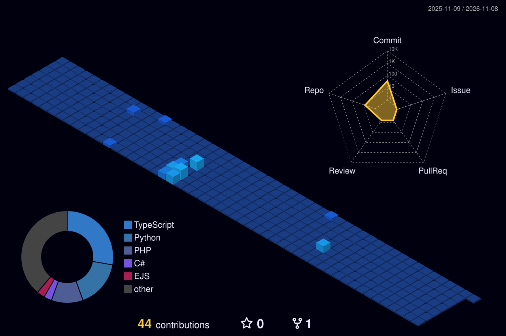

 

> Pick the right tool for the problem, not the trendiest one.

I want to build software that solves real business problems and keeps paying off for years, and I'd like TNXBD to be the partner companies trust when the work has to be scalable, secure and done properly.

 

Have a project in mind, or just want to talk shop? Send a message.

<a href="mailto:info@tnxbd.com"><b>info@tnxbd.com</b></a> &nbsp;·&nbsp;
<a href="https://wa.me/8801884444299">WhatsApp</a> &nbsp;·&nbsp;
<a href="https://hellonayeem.com">hellonayeem.com</a> &nbsp;·&nbsp;
<a href="https://website-tnxbd.vercel.app">TNXBD IT Solution</a>


