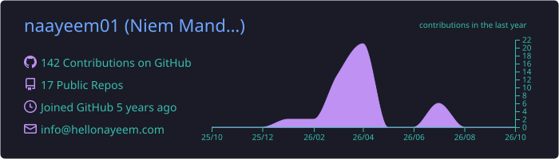
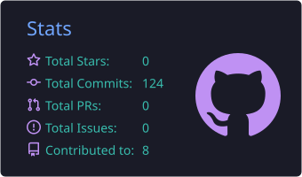
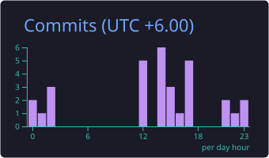
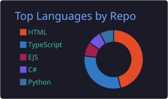
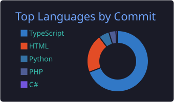
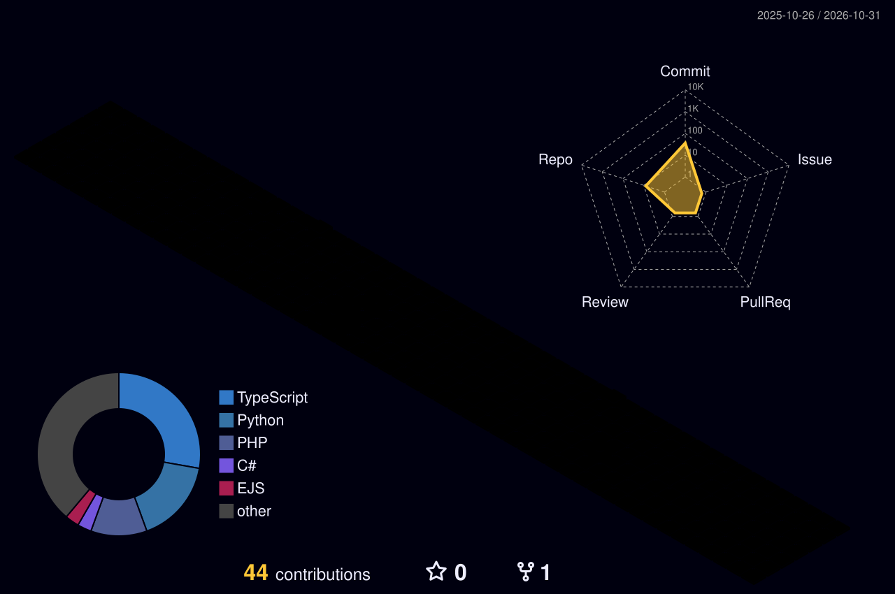

<div align="center">

<a href="https://hellonayeem.com">
  
</a>

<a href="https://github.com/naayeem01">
  
</a>

<p>
  <a href="https://hellonayeem.com"></a>
  <a href="mailto:info@tnxbd.com"></a>
  <a href="https://github.com/naayeem01?tab=followers"></a>
  
</p>

</div>


## 👨‍💻 About Me

<table>
<tr>
<td width="58%" valign="top">

```typescript
const niemMandol = {
  role:     "Founder & CTO @ TNXBD IT SOLUTION",
  location: "Mirpur, Dhaka 🇧🇩",
  focus:    ["Enterprise Web Apps", "Cloud Architecture", "Team Leadership"],
  passion:  "Turning complex business problems into elegant technical solutions",
  contact: {
    email:   "info@tnxbd.com",
    phone:   "+880 1884-444299",
    website: "hellonayeem.com",
  },
  currentlyExploring: "AI/ML integration for intelligent enterprise solutions 🤖",
};
```

</td>
<td width="42%" valign="top">

🏢 I lead **TNXBD IT SOLUTION** — a software development agency delivering enterprise-grade, production-ready applications for clients worldwide.

- ⚡ **5+ years** shipping full-stack products
- 🧩 Architect of SaaS, ERP & HRMS platforms
- ☁️ Cloud-native on **AWS / Azure**
- 🔐 Security-first, NDA-bound client work
- 🌱 Currently learning: **LLM agents & MLOps**

</td>
</tr>
</table>


## 🛠️ Tech Stack

<div align="center">
  
</div>

<details open>
<summary><b>🎨 Frontend</b> — click to collapse</summary>
<br/>
<p align="center"></p>
</details>

<details>
<summary><b>⚙️ Backend</b> — click to expand</summary>
<br/>
<p align="center"></p>
</details>

<details>
<summary><b>🗄️ Databases</b> — click to expand</summary>
<br/>
<p align="center"></p>
</details>

<details>
<summary><b>☁️ Cloud & DevOps</b> — click to expand</summary>
<br/>
<p align="center"></p>
</details>

<details>
<summary><b>🔧 Tools</b> — click to expand</summary>
<br/>
<p align="center"></p>
</details>

<details>
<summary><b>💼 Core Expertise</b> — click to expand</summary>
<br/>

| Skill | Area | Proficiency |
|:--|:--|:--|
| Git & GitHub | Version Control | `███████████████████░` 99% |
| RESTful API Design | Integration | `███████████████████░` 98% |
| System Architecture | Design | `███████████████████░` 97% |
| AWS / Azure | Cloud | `███████████████████░` 96% |
| PostgreSQL / MongoDB | Databases | `███████████████████░` 96% |
| React.js / Next.js | Frontend | `███████████████████░` 95% |
| Node.js / NestJS | Backend | `███████████████████░` 95% |
| CI/CD Pipelines | DevOps | `██████████████████░░` 94% |

</details>


## 🚀 Featured Projects

<table>
<tr>
<td width="50%" valign="top">

### [🔗 ShortLink](https://github.com/naayeem01/ShortLink)
Premium URL shortener with glassmorphism UI, real-time click analytics and a Supabase-auth admin dashboard.


[](https://short-link-eta-seven.vercel.app)

</td>
<td width="50%" valign="top">

### [✂️ Trimly](https://github.com/naayeem01/Trimly)
Self-hosted URL shortener with click analytics, QR codes and a token-authenticated JSON API.


</td>
</tr>
<tr>
<td width="50%" valign="top">

### [🖐️ ZKTeco ADMS Manager](https://github.com/naayeem01/Zkteco-Link-DSK)
Desktop app for ZKTeco biometric devices — ADMS push server, employee management, attendance logs and live monitoring.


</td>
<td width="50%" valign="top">

### [🏥 MediSlot](https://github.com/naayeem01/MediSlot)
Healthcare appointment & slot-booking web app built on the Next.js App Router.


[](https://medi-slot-six.vercel.app)

</td>
</tr>
<tr>
<td width="50%" valign="top">

### [🌐 TNXBD Website](https://github.com/naayeem01/Website-tnxbd)
The company site for TNXBD IT SOLUTION — fast React + Vite + TypeScript build.


[](https://website-tnxbd.vercel.app)

</td>
<td width="50%" valign="top">

### [🔒 Client Work](mailto:info@tnxbd.com)
Most of my work lives in private repos under NDA — ERP, HRMS, fintech and e-commerce platforms for enterprise clients.


[](mailto:info@tnxbd.com)

</td>
</tr>
</table>


## 📊 GitHub Analytics

<div align="center">









<picture>
  <source media="(prefers-color-scheme: dark)" srcset="https://streak-stats.demolab.com?user=naayeem01&theme=tokyonight&hide_border=true&background=0d1117&ring=58a6ff&fire=ff6b9d&currStreakLabel=58a6ff"/>
  <source media="(prefers-color-scheme: light)" srcset="https://streak-stats.demolab.com?user=naayeem01&theme=default&hide_border=true&ring=0969da&fire=d6336c&currStreakLabel=0969da"/>
  
</picture>

</div>

### 🏙️ Contribution Skyline

<div align="center">
<picture>
  <source media="(prefers-color-scheme: dark)" srcset="./profile-3d-contrib/profile-night-rainbow.svg"/>
  <source media="(prefers-color-scheme: light)" srcset="./profile-3d-contrib/profile-green-animate.svg"/>
  
</picture>
</div>

### 🐍 Contribution Snake

<div align="center">
<picture>
  <source media="(prefers-color-scheme: dark)" srcset="https://raw.githubusercontent.com/naayeem01/naayeem01/output/github-snake-dark.svg"/>
  <source media="(prefers-color-scheme: light)" srcset="https://raw.githubusercontent.com/naayeem01/naayeem01/output/github-snake.svg"/>
  
</picture>
</div>


## 🧭 What I Build

<details>
<summary><b>🛒 E-Commerce · ☁️ SaaS · 📊 Analytics · 🏢 Enterprise · 🔌 APIs · 📱 Web Apps</b> — click to expand</summary>
<br/>

| 🛒 E-Commerce | ☁️ SaaS Platforms | 📊 Analytics |
|:---:|:---:|:---:|
| Full-stack storefronts | Multi-tenant architectures | Real-time dashboards |
| Payment integrations | RBAC & subscription systems | BI platforms |
| Multi-vendor marketplaces | Third-party integrations | Forecasting tools |

| 🏢 Enterprise Systems | 🔌 API & Integrations | 📱 Web Apps |
|:---:|:---:|:---:|
| ERP / HRMS modules | RESTful & GraphQL APIs | Progressive Web Apps |
| Supply chain & biometrics | Legacy system migration | SPAs & responsive UI |
| Financial management | Data sync services | Mobile-first solutions |

</details>

<details>
<summary><b>🌍 Industries Served</b> — click to expand</summary>
<br/>
<p align="center">

`💰 Financial Services` `🛍️ E-Commerce & Retail` `🏥 Healthcare` `🏭 Manufacturing`
`🏠 Real Estate` `🎓 EdTech` `📡 Telecommunications` `🏛️ Government`

</p>
</details>


## 📫 Let's Connect

<div align="center">

[](mailto:info@tnxbd.com)
[](https://wa.me/8801884444299)
[](https://hellonayeem.com)
<br/>
[](https://website-tnxbd.vercel.app)
[](https://maps.google.com/?q=Mirpur+Dhaka+Bangladesh)
[](https://github.com/naayeem01)

<br/><br/>

> *"Select the optimal technology for each specific problem — not the trendiest one."*

**Mission** — Deliver exceptional software that solves complex business problems and drives measurable value.<br/>
**Vision** — Be the trusted technology partner for enterprises seeking scalable, innovative, and secure custom software.

<br/>


</div>
