<a href="https://hellonayeem.com">
<picture>
  <source media="(prefers-color-scheme: dark)" srcset="./assets/header-dark.svg">
  
</picture>
</a>

 

Hi, I'm Niem. I run **[TNXBD IT Solution](https://website-tnxbd.vercel.app)**, a small software studio in Mirpur, Dhaka. For the last five years I've been designing and building the systems businesses run on: ERPs, HR platforms, online stores and the APIs that tie them together.

I like boring, reliable technology, clear code and shipping things people actually use.

<table>
  <tr><td>NOW</td><td>Shipping ShortLink v2 and learning LLM agents</td></tr>
  <tr><td>STACK</td><td>TypeScript · Node / NestJS · Laravel · Python · PostgreSQL · AWS</td></tr>
  <tr><td>BASED IN</td><td>Mirpur, Dhaka, Bangladesh</td></tr>
  <tr><td>REACH ME</td><td><a href="mailto:info@tnxbd.com">info@tnxbd.com</a> · <a href="https://wa.me/8801884444299">WhatsApp</a> · <a href="https://hellonayeem.com">hellonayeem.com</a></td></tr>
</table>

<picture>
  <source media="(prefers-color-scheme: dark)" srcset="./assets/rule-dark.svg">
  
</picture>

### Selected work

Click any row to open the repo.

<a href="https://github.com/naayeem01/ShortLink">
<picture>
  <source media="(prefers-color-scheme: dark)" srcset="./assets/work-shortlink-dark.svg">
  
</picture>
</a>
<a href="https://github.com/naayeem01/Trimly">
<picture>
  <source media="(prefers-color-scheme: dark)" srcset="./assets/work-trimly-dark.svg">
  
</picture>
</a>
<a href="https://github.com/naayeem01/Zkteco-Link-DSK">
<picture>
  <source media="(prefers-color-scheme: dark)" srcset="./assets/work-zkteco-dark.svg">
  
</picture>
</a>
<a href="https://github.com/naayeem01/MediSlot">
<picture>
  <source media="(prefers-color-scheme: dark)" srcset="./assets/work-medislot-dark.svg">
  
</picture>
</a>
<a href="https://github.com/naayeem01/Website-tnxbd">
<picture>
  <source media="(prefers-color-scheme: dark)" srcset="./assets/work-tnxbd-dark.svg">
  
</picture>
</a>

Most of my client work (ERP, HRMS, fintech, e-commerce) lives in private repos under NDA. <a href="mailto:info@tnxbd.com">Ask me for a case study.</a>

<picture>
  <source media="(prefers-color-scheme: dark)" srcset="./assets/rule-dark.svg">
  
</picture>

### Toolbox

<picture>
  <source media="(prefers-color-scheme: dark)" srcset="https://skillicons.dev/icons?i=ts,react,nextjs,nodejs,nestjs,laravel,python,postgres,mongodb,aws,docker,githubactions&perline=12&theme=dark">
  
</picture>

<b>Full toolbox</b> (click to open)

 

**Frontend** 
<picture>
  <source media="(prefers-color-scheme: dark)" srcset="https://skillicons.dev/icons?i=react,nextjs,ts,js,tailwind,html,css,redux,vite,jest&perline=10&theme=dark">
  
</picture>

**Backend** 
<picture>
  <source media="(prefers-color-scheme: dark)" srcset="https://skillicons.dev/icons?i=nodejs,express,nestjs,python,fastapi,django,flask,php,laravel,graphql&perline=10&theme=dark">
  
</picture>

**Data** 
<picture>
  <source media="(prefers-color-scheme: dark)" srcset="https://skillicons.dev/icons?i=postgres,mysql,mongodb,redis,supabase,firebase&perline=10&theme=dark">
  
</picture>

**Cloud & DevOps** 
<picture>
  <source media="(prefers-color-scheme: dark)" srcset="https://skillicons.dev/icons?i=aws,azure,docker,kubernetes,githubactions,jenkins,terraform,nginx,linux,vercel&perline=10&theme=dark">
  
</picture>

**Everyday tools** 
<picture>
  <source media="(prefers-color-scheme: dark)" srcset="https://skillicons.dev/icons?i=git,github,vscode,postman,figma&perline=10&theme=dark">
  
</picture>

<b>How I'd rate myself</b> (click to open)

 

| | |
|:--|:--|
| API design (REST, GraphQL) | `■■■■■■■■■□` |
| System architecture | `■■■■■■■■■□` |
| React / Next.js | `■■■■■■■■■□` |
| Node.js / NestJS | `■■■■■■■■■□` |
| PostgreSQL / MongoDB | `■■■■■■■■□□` |
| AWS / Azure | `■■■■■■■■□□` |
| CI/CD & Docker | `■■■■■■■■□□` |
| Laravel / PHP | `■■■■■■■□□□` |
| Machine learning | `■■■■□□□□□□` still learning |

<b>What I build, and for whom</b> (click to open)

 

**Things I build**

- **E-commerce:** storefronts, multi-vendor marketplaces, payment integrations
- **SaaS:** multi-tenant apps with roles, subscriptions and third-party integrations
- **Enterprise:** ERP and HRMS modules, supply chain, biometric attendance, finance
- **Analytics:** real-time dashboards, BI and forecasting tools
- **APIs:** REST and GraphQL services, legacy migrations, data sync
- **Web apps:** SPAs and PWAs that work well on phones first

**Industries I've worked with**

Financial services · Retail · Healthcare · Manufacturing · Real estate · Education · Telecom · Government

<picture>
  <source media="(prefers-color-scheme: dark)" srcset="./assets/rule-dark.svg">
  
</picture>

### On GitHub

<picture>
  <source media="(prefers-color-scheme: dark)" srcset="./profile-summary-card-output/github_dark/0-profile-details.svg">
  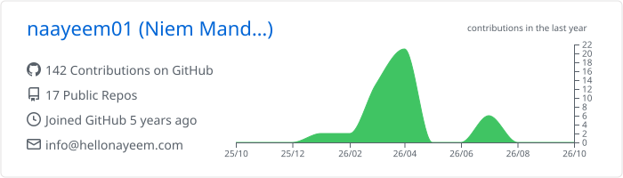
</picture>

<picture>
  <source media="(prefers-color-scheme: dark)" srcset="./profile-summary-card-output/github_dark/3-stats.svg">
  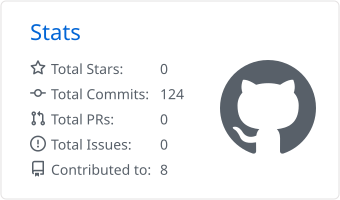
</picture>
<picture>
  <source media="(prefers-color-scheme: dark)" srcset="./profile-summary-card-output/github_dark/4-productive-time.svg">
  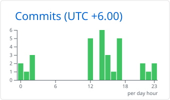
</picture>
<picture>
  <source media="(prefers-color-scheme: dark)" srcset="./profile-summary-card-output/github_dark/1-repos-per-language.svg">
  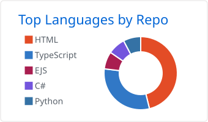
</picture>
<picture>
  <source media="(prefers-color-scheme: dark)" srcset="./profile-summary-card-output/github_dark/2-most-commit-language.svg">
  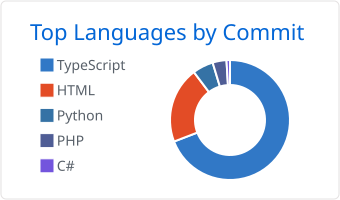
</picture>

<picture>
  <source media="(prefers-color-scheme: dark)" srcset="https://streak-stats.demolab.com?user=naayeem01&hide_border=true&date_format=j%20M%5B%20Y%5D&background=0d1117&ring=f0883e&fire=f0883e&currStreakLabel=f0883e&sideNums=e6edf3&currStreakNum=e6edf3&sideLabels=8b949e&dates=8b949e&stroke=30363d">
  
</picture>

<b>Contribution graph</b> (public activity, refreshed daily)

 

<picture>
  <source media="(prefers-color-scheme: dark)" srcset="./profile-3d-contrib/profile-night-view.svg">
  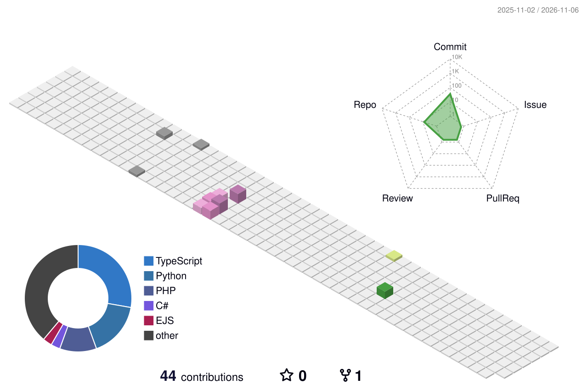
</picture>

<picture>
  <source media="(prefers-color-scheme: dark)" srcset="https://raw.githubusercontent.com/naayeem01/naayeem01/output/github-snake-dark.svg">
  
</picture>

<picture>
  <source media="(prefers-color-scheme: dark)" srcset="./assets/rule-dark.svg">
  
</picture>

### What I believe

> Pick the right tool for the problem, not the trendiest one.

I want to build software that solves real business problems and keeps paying off for years. I'd like TNXBD to be the partner companies trust when the work has to be scalable, secure and done properly.

<picture>
  <source media="(prefers-color-scheme: dark)" srcset="./assets/rule-dark.svg">
  
</picture>

<a href="mailto:info@tnxbd.com">Email</a> ·
<a href="https://wa.me/8801884444299">WhatsApp</a> ·
<a href="https://hellonayeem.com">Website</a> ·
<a href="https://website-tnxbd.vercel.app">TNXBD IT Solution</a>

<i>— Niem, Dhaka</i> &nbsp;·&nbsp; 
