<a href="https://hellonayeem.com"></a>

I'm Niem, founder of <a href="https://website-tnxbd.vercel.app"><b>TNXBD IT Solution</b></a>, a software company in Mirpur, Dhaka.
For more than five years we have designed and built the systems businesses run on every day: diagnostic and lab software, pharmacy and clinic platforms, HR and payroll, ERPs and the APIs that connect them.
Our products are built for real conditions in Bangladesh. They keep working when the internet drops and sync automatically when it comes back.

 


<a href="mailto:info@tnxbd.com?subject=DiagoNet%20demo"></a>
<a href="mailto:info@tnxbd.com?subject=OushodCloud%20demo"></a>
<a href="https://github.com/naayeem01/MediSlot"></a>
<a href="mailto:info@tnxbd.com?subject=KormoLink%20demo"></a>

| Product | Built for | Highlights | Online / Offline |
| :-- | :-- | :-- | :-: |
| **DiagoNet** | Diagnostic centres & labs | LIS, analyzer interfacing (ASTM / HL7), automatic result import, report printing | ✅ / ✅ |
| **OushodCloud** | Pharmacies & chains | POS & billing, stock and expiry alerts, suppliers & purchase, multi-branch sync | ✅ / ✅ |
| **MediSlot** | Clinics & doctor chambers | Online booking, doctor schedules, serial & queue display, SMS reminders | ✅ |
| **KormoLink** | Companies & factories | HR, payroll & payslips, fingerprint and face attendance devices, ID card printing | ✅ / ✅ |

Want a walkthrough? <a href="mailto:info@tnxbd.com?subject=Product%20demo">Book a free demo</a> or message us on <a href="https://wa.me/8801884444299">WhatsApp</a>.

  


<a href="https://github.com/naayeem01/ShortLink"></a>
<a href="https://github.com/naayeem01/Trimly"></a>
<a href="https://github.com/naayeem01/Zkteco-Link-DSK"></a>
<a href="https://github.com/naayeem01/MediSlot"></a>
<a href="https://github.com/naayeem01/Website-tnxbd"></a>

Most client work (ERP, HRMS, fintech, e-commerce) lives in private repositories under NDA. <a href="mailto:info@tnxbd.com">Ask for a case study.</a>

  



<b>Open the full toolbox</b>

 

**Frontend** 

**Backend** 

**Data** 

**Cloud & DevOps** 

**Everyday tools** 

<b>What we build, and for whom</b>

 

- **Healthcare:** diagnostic centre & LIS, pharmacy management, doctor appointments
- **Enterprise:** ERP and HRMS modules, payroll, biometric attendance, supply chain, finance
- **E-commerce:** storefronts, multi-vendor marketplaces, payment integrations
- **SaaS:** multi-tenant apps with roles, subscriptions and third-party integrations
- **Analytics:** real-time dashboards, BI and forecasting tools
- **APIs:** REST and GraphQL services, device integrations, legacy migrations, data sync

**Industries:** healthcare · financial services · retail · manufacturing · real estate · education · telecom · government

 


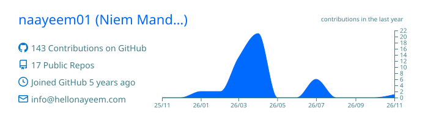

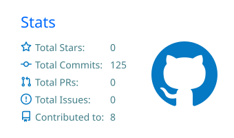
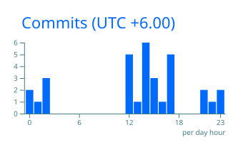
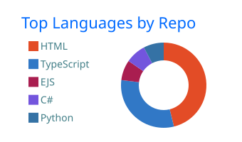
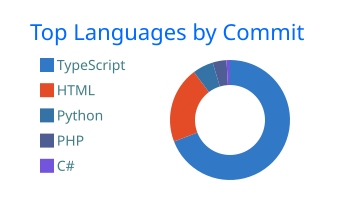

<b>Contribution graph</b> (public activity, refreshed daily)

 

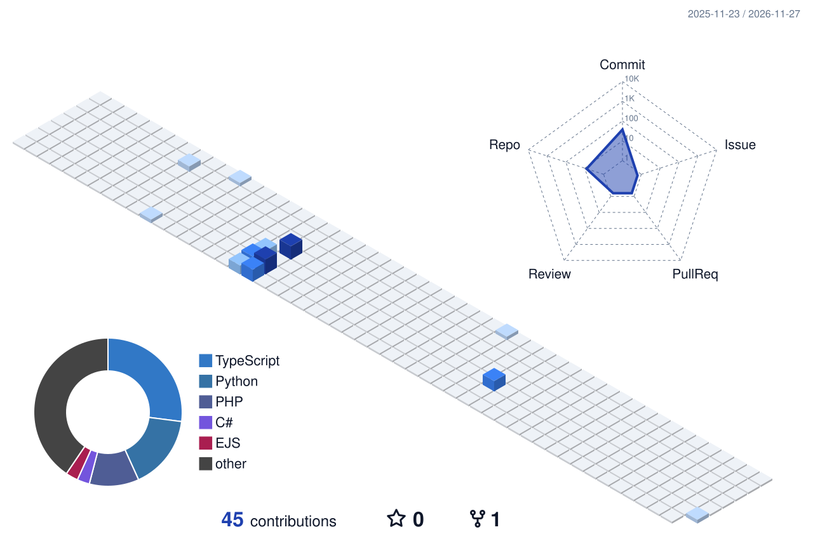

 


Have a project in mind, want a product demo, or just want to talk shop? Send a message.

<a href="mailto:info@tnxbd.com"><b>info@tnxbd.com</b></a> &nbsp;·&nbsp;
<a href="https://wa.me/8801884444299">WhatsApp</a> &nbsp;·&nbsp;
<a href="https://hellonayeem.com">hellonayeem.com</a> &nbsp;·&nbsp;
<a href="https://website-tnxbd.vercel.app">TNXBD IT Solution</a>

